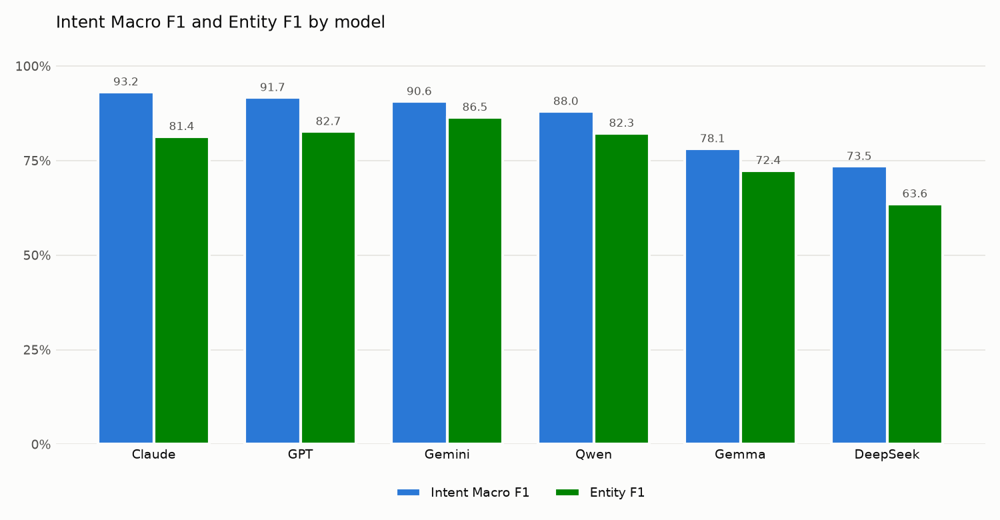

# Myanglish-BizBench

**Can general-purpose LLMs understand Myanglish customer messages?** A benchmark, an evaluation
of six LLMs, and a small app that puts the results to use.

🤗 Dataset: [aungthuhein-dev/myanglish-bizbench](https://huggingface.co/datasets/aungthuhein-dev/myanglish-bizbench) · 📄 [Final report](reports/final_report.md) · 🛠 [Analyzer app](app/README.md)

Myanglish is Burmese written in Latin letters, often mixed with English. It's how many people
in Myanmar message online shops:

> `sis black L size 1 khu yuu mal, yankin ko deli kha bl lout lal`
> *"Sis, I'll take one black in size L. How much is delivery to Yankin?"*
> → intents `place_order`, `delivery_inquiry` · entities color `black`, size `L`, quantity `1`, location `Yankin`

## Results (v0.2, zero-shot, 100 messages)

| Model | Intent Macro F1 [95% CI] | Exact match | Entity F1 | Cost / 1K msgs | p90 latency |
|---|---|---|---|---|---|
| Claude (`claude-opus-5-5`) | **93.2** [88.6–96.2] | **84.0** | 81.4 | $10.82 | 3.9 s |
| GPT (`gpt-6.2-sol`) | 91.7 [86.9–95.1] | 81.0 | 82.7 | $2.88 | 3.4 s |
| Gemini (`gemini-4-carbon`) | 90.6 [85.4–94.1] | 79.0 | **86.5** | $5.48 | 16.3 s |
| Qwen (`qwen4-max`) | 88.0 [82.3–92.1] | 75.0 | 82.3 | $3.35 | 18.3 s |
| Gemma (`gemma-4-31b-it`) | 78.1 [70.0–83.5] | 62.0 | 72.4 | **$0.22** | **1.8 s** |
| DeepSeek (`deepseek-v4-pro`) | 73.5 [65.2–79.2] | 53.0 | 63.6 | $2.37 | 35.2 s |



**Key findings**

1. **The top three are statistically tied.** Claude, GPT and Gemini reach 91–93% intent Macro F1
   with no Myanglish examples or fine-tuning.
2. **Pure Myanglish is the real gap.** Messages with no English words score 7–29 points lower,
   for every model.
3. **Most remaining frontier errors come from label ambiguity, not misunderstanding.** Writing
   down the labelling rules raised entity F1 by about 10 points with no change to the models.
4. **Fine-tuning isn't justified for accuracy.** The case for it would be cost and latency, and
   Gemma already costs $0.22 per 1K messages.

📄 **[Final research report](reports/final_report.md)**: method, results, failure analysis,
limitations and conclusions.

## Repository

| Path | Contents |
|---|---|
| `data/v0.2/test.jsonl` | **Benchmark v0.2** (frozen; SHA-256 in `MANIFEST.json`) |
| `data/v0.1/test.jsonl` | Benchmark v0.1 (frozen) |
| `data/raw/`, `data/human-fixed/`, `data/interim/` | Provenance: LLM generations → human corrections → merged |
| `data/v0.2/review_sheet*.csv` | Blind human review for v0.2 (as submitted, and cleaned) |
| `src/` | Evaluation: provider adapters, prompts and schema, metrics, evaluator |
| `scripts/` | Validation, analysis, freezing, failure analysis, bootstrap CIs, checksums |
| `results/` (v0.1), `results/v0.2/` | Every model prediction (raw output, tokens, latency), scores, prices |
| `reports/` | Final report, dataset report, failure analyses, guidelines, changelog |
| `app/` | **[Myanglish Message Analyzer](app/README.md)**: the findings applied to a working service |
| `SHA256SUMS.txt` | Checksums for every data and result file |

## Data format

One JSON object per line:

```json
{"id": "mbb_0078", "source_model": "gemini",
 "text": "black L size 1 htal u ml ygn yankin ko deli kha bl lout ll",
 "normalized_burmese": "…", "english_meaning": "…",
 "intents": ["place_order", "delivery_inquiry"],
 "entities": {"color": "black", "size": "L", "quantity": 1, "location": ["Yankin", "Yangon"]},
 "writing_style": "myanglish_english", "difficulty": "medium", "context": null,
 "requires_clarification": false}
```

There are 12 intents (multi-label) and 15 entity types. The rules are in
[`reports/annotation_guidelines_v0.2.md`](reports/annotation_guidelines_v0.2.md).

## Reproduce

```powershell
pip install -r requirements.txt
```

```powershell
copy .env.example .env
```

Add your API keys to `.env`, then:

```powershell
python -m src.evaluator --version v0.2
```

Saved predictions are reused, so this only calls APIs for missing samples. Re-scoring, the
analysis and the checks below make no API calls:

```powershell
python -m src.evaluator --version v0.2 --summary-only
```

```powershell
python scripts/failure_analysis.py --version v0.2
```

```powershell
python scripts/bootstrap_ci.py --version v0.2
```

```powershell
python scripts/freeze_dataset.py --version v0.2 --verify
```

```powershell
python scripts/make_checksums.py --check
```

```powershell
python -m unittest discover tests
```

## Use policy and limitations

- **Test set only.** Don't train or fine-tune on it. Fixes go into a new version; frozen
  versions are never edited.
- The messages were written by LLMs (ChatGPT, Claude, DeepSeek, Gemini) and corrected by one
  native speaker. They are not real customer messages and contain no personal data.
- The test set is small (100 messages), so differences under about 5 points aren't meaningful
  rankings. See the report's limitations section.

## License

Code: MIT. Data, predictions and reports: CC BY 4.0. See [`LICENSE`](LICENSE) and
[`CITATION.cff`](CITATION.cff).
