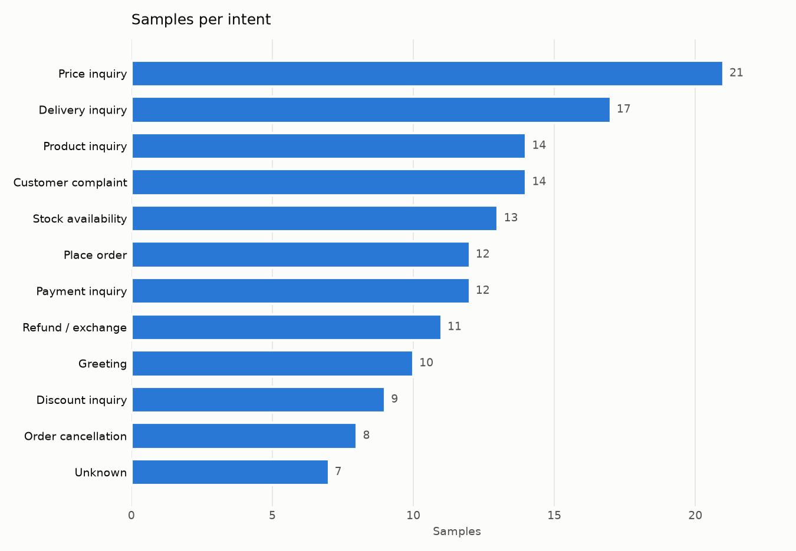
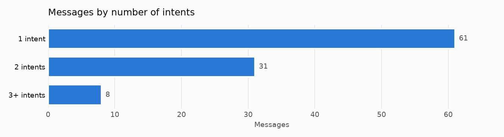
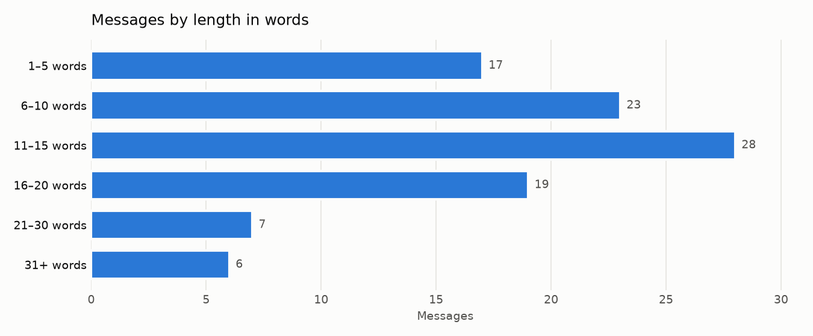
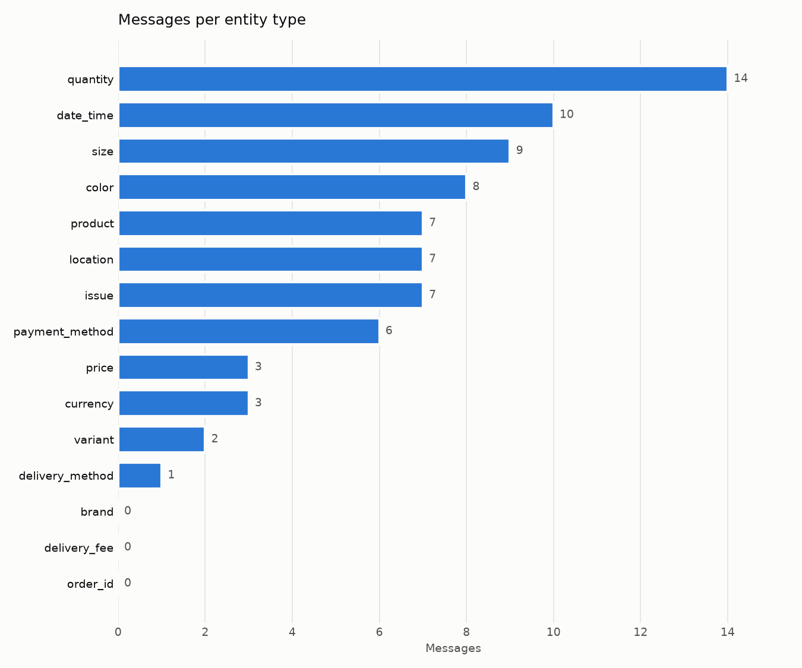

# Myanglish-BizBench Dataset Report

Generated 2026-11-18 from `merged.json` by `scripts/analyze_dataset.py`.

## 1. Validation summary

```
=== Myanglish-BizBench Dataset Report ===

Total samples: 100
Valid samples: 100
Invalid samples: 0
Duplicate messages: 0
Missing fields: 0
Unique intents: 12
Multi-intent samples: 39
Context-dependent samples: 4

Status: PASS
```

Definitions: a sample is **invalid** if it fails any check in `scripts/validate_dataset.py` (missing/extra fields, wrong types, values outside the allowed sets, non-canonical intent labels, duplicate id). Samples whose only intent is `unknown` (emoji-only or slang messages) may have an empty or non-Burmese `normalized_burmese`. **Duplicate messages** compares `text` after lower-casing and collapsing spaces. **Context-dependent** means `context` is not null.

## 2. Dataset composition

### By source model

| source_model | Count | Share |
|---|---|---|
| chatgpt | 25 | 25.0% |
| claude | 25 | 25.0% |
| deepseek | 25 | 25.0% |
| gemini | 25 | 25.0% |

### By writing style

| writing_style | Count | Share |
|---|---|---|
| myanglish_english | 64 | 64.0% |
| myanglish | 36 | 36.0% |

### By difficulty

| difficulty | Count | Share |
|---|---|---|
| medium | 48 | 48.0% |
| easy | 26 | 26.0% |
| hard | 26 | 26.0% |

### Difficulty by source model

| source_model | easy | hard | medium | total |
|---|---|---|---|---|
| chatgpt | 6 | 9 | 10 | 25 |
| claude | 6 | 6 | 13 | 25 |
| deepseek | 7 | 4 | 14 | 25 |
| gemini | 7 | 7 | 11 | 25 |

### Writing style by source model

| source_model | myanglish | myanglish_english | total |
|---|---|---|---|
| chatgpt | 5 | 20 | 25 |
| claude | 6 | 19 | 25 |
| deepseek | 21 | 4 | 25 |
| gemini | 4 | 21 | 25 |

## 3. Intents

148 intent labels across 100 samples (1.48 per sample on average).

### Intent frequency



| intent | samples | share of samples |
|---|---|---|
| price_inquiry | 21 | 21.0% |
| delivery_inquiry | 17 | 17.0% |
| product_inquiry | 14 | 14.0% |
| customer_complaint | 14 | 14.0% |
| stock_availability | 13 | 13.0% |
| place_order | 12 | 12.0% |
| payment_inquiry | 12 | 12.0% |
| refund_exchange | 11 | 11.0% |
| greeting | 10 | 10.0% |
| discount_inquiry | 9 | 9.0% |
| order_cancellation | 8 | 8.0% |
| unknown | 7 | 7.0% |

### A. Multi-intent distribution

39 of 100 messages (39.0%) carry more than one intent.



| intents per message | messages | share |
|---|---|---|
| 1 intent | 61 | 61.0% |
| 2 intents | 31 | 31.0% |
| 3+ intents | 8 | 8.0% |

Exact counts: 1 intent = 61, 2 intents = 31, 3 intents = 7, 4 intents = 1.

#### By source model

| source_model | 1 intent | 2 intents | 3+ intents | multi-intent share |
|---|---|---|---|---|
| chatgpt | 18 | 5 | 2 | 28.0% |
| claude | 19 | 4 | 2 | 24.0% |
| deepseek | 10 | 12 | 3 | 60.0% |
| gemini | 14 | 10 | 1 | 44.0% |

#### Most common intent pairs

| intent A | intent B | count |
|---|---|---|
| customer_complaint | refund_exchange | 7 |
| price_inquiry | product_inquiry | 6 |
| delivery_inquiry | place_order | 5 |
| delivery_inquiry | price_inquiry | 5 |
| price_inquiry | stock_availability | 5 |
| customer_complaint | delivery_inquiry | 4 |
| discount_inquiry | price_inquiry | 4 |
| product_inquiry | stock_availability | 4 |
| place_order | price_inquiry | 2 |
| order_cancellation | place_order | 2 |

### Intent coverage by source model

| intent | chatgpt | claude | deepseek | gemini |
|---|---|---|---|---|
| price_inquiry | 6 | 3 | 8 | 4 |
| delivery_inquiry | 4 | 3 | 6 | 4 |
| product_inquiry | 2 | 2 | 6 | 4 |
| customer_complaint | 3 | 5 | 3 | 3 |
| stock_availability | 5 | 2 | 3 | 3 |
| place_order | 3 | 2 | 3 | 4 |
| payment_inquiry | 2 | 3 | 4 | 3 |
| refund_exchange | 2 | 3 | 3 | 3 |
| greeting | 2 | 3 | 2 | 3 |
| discount_inquiry | 2 | 2 | 3 | 2 |
| order_cancellation | 2 | 2 | 2 | 2 |
| unknown | 2 | 3 | 0 | 2 |

## 4. Message text

### B. Message length distribution

Length is measured on `text` in words (space-separated tokens) and in characters (including spaces and emoji).

| unit | min | mean | median | max |
|---|---|---|---|---|
| words | 1 | 13.5 | 13.0 | 41 |
| characters | 2 | 54.5 | 52.5 | 163 |

- Shortest: `mbb_0038` `😂😂` (2 chars)
- Longest (by characters): `mbb_0025` (39 words, 163 chars)



| length | messages | share |
|---|---|---|
| 1–5 words | 17 | 17.0% |
| 6–10 words | 23 | 23.0% |
| 11–15 words | 28 | 28.0% |
| 16–20 words | 19 | 19.0% |
| 21–30 words | 7 | 7.0% |
| 31+ words | 6 | 6.0% |

#### Length by group

| group | n | min words | mean words | median words | max words | mean chars | median chars |
|---|---|---|---|---|---|---|---|
| chatgpt | 25 | 3 | 15.0 | 14 | 39 | 64.2 | 60 |
| claude | 25 | 1 | 10.5 | 9 | 41 | 41.6 | 36 |
| deepseek | 25 | 3 | 13.3 | 14 | 32 | 50.9 | 51 |
| gemini | 25 | 1 | 15.3 | 15 | 36 | 61.3 | 58 |
| difficulty=easy | 26 | 2 | 7.4 | 7.0 | 17 | 30.6 | 27.0 |
| difficulty=medium | 48 | 5 | 14.7 | 15.0 | 32 | 59.6 | 60.5 |
| difficulty=hard | 26 | 1 | 17.4 | 15.5 | 41 | 69.1 | 65.5 |
| style=myanglish | 36 | 1 | 10.7 | 10.0 | 32 | 41.0 | 44.5 |
| style=myanglish_english | 64 | 1 | 15.1 | 14.0 | 41 | 62.1 | 57.0 |

- Messages containing digits: 21 (21.0%)
- Messages containing emoji: 4 (4.0%)
- Distinct tokens (lower-cased, space-split): 352

### Top 20 tokens

| token | count |
|---|---|
| ma | 59 |
| ka | 40 |
| ya | 39 |
| lar | 36 |
| pay | 34 |
| lr | 32 |
| lal | 24 |
| loh | 24 |
| buu | 24 |
| shi | 23 |
| lay | 21 |
| pr | 21 |
| poh | 20 |
| ah | 17 |
| nae | 17 |
| lo | 17 |
| naw | 16 |
| khu | 16 |
| bl | 15 |
| yuu | 14 |

## 5. Entities

- Samples with at least one entity: 54 (54.0%)
- Samples with no entities: 46 (46.0%)
- Entity keys in use: 12 of the 15 standard keys
- Standard keys with no annotations: `brand`, `delivery_fee`, `order_id`

### C. Entity distribution

Entities follow the standard schema (15 keys, enforced by `scripts/validate_dataset.py`; the mapping from the original keys is in `scripts/standardize_entities.py`). **Samples** counts messages with that key; **values** counts every annotated value (a list of two colours counts as 2).



| entity key | samples | share of samples | values | example values |
|---|---|---|---|---|
| `quantity` | 14 | 14.0% | 15 | 1; 2 |
| `date_time` | 10 | 10.0% | 12 | yesterday; today; 11.11 promo; 1 week |
| `size` | 9 | 9.0% | 12 | 38; 39; XL; M |
| `color` | 8 | 8.0% | 11 | black; white; blue; pink |
| `product` | 7 | 7.0% | 7 | bag; sneakers; phone_case; shirt |
| `location` | 7 | 7.0% | 8 | Mandalay; Yangon; Yankin, Yangon; Hlaldan |
| `issue` | 7 | 7.0% | 8 | tracking not provided; size too small; color mismatch; poor quality |
| `payment_method` | 6 | 6.0% | 9 | KBZPay; COD; WavePay |
| `price` | 3 | 3.0% | 4 | 20000; 10000; 30000; 100000 |
| `currency` | 3 | 3.0% | 3 | MMK |
| `variant` | 2 | 2.0% | 5 | genuine leather; faux leather; waterproof; iPhone 13 |
| `delivery_method` | 1 | 1.0% | 1 | highway bus gate |
| `brand` | 0 | 0.0% | 0 | — |
| `delivery_fee` | 0 | 0.0% | 0 | — |
| `order_id` | 0 | 0.0% | 0 | — |

#### Entity keys by source model

| entity key | chatgpt | claude | deepseek | gemini |
|---|---|---|---|---|
| `quantity` | 3 | 3 | 4 | 4 |
| `date_time` | 3 | 4 | 0 | 3 |
| `size` | 1 | 3 | 2 | 3 |
| `color` | 2 | 2 | 1 | 3 |
| `product` | 3 | 2 | 0 | 2 |
| `location` | 1 | 1 | 2 | 3 |
| `issue` | 4 | 0 | 0 | 3 |
| `payment_method` | 1 | 2 | 0 | 3 |
| `price` | 2 | 0 | 0 | 1 |
| `currency` | 2 | 0 | 0 | 1 |
| `variant` | 2 | 0 | 0 | 0 |
| `delivery_method` | 0 | 0 | 0 | 1 |
| no entities | 9 | 12 | 17 | 8 |

## 6. Clarification and context

- Samples requiring clarification: 30 (30.0%)
- Context-dependent samples: 4 (4.0%)

### Requires clarification by difficulty

| difficulty | False | True | total |
|---|---|---|---|
| easy | 21 | 5 | 26 |
| hard | 10 | 16 | 26 |
| medium | 39 | 9 | 48 |

### Context-dependent samples

| id | text | context |
|---|---|---|
| mbb_0075 | hi sis d hr lay bl lout ll | Customer likely replied to a product photo or post. |
| mbb_0084 | cb | Common shorthand sent without context expecting the shop to initiate. |
| mbb_0091 | a paw ka hr | Customer points to an earlier post/message without stating whether they want price, stock, or to order. |
| mbb_0092 | wave nae phyaung pyii pyi naw ss poh htar talkyi pyi order confirm pay pr | Uses Gen-Z slang 'phyaung' (ဖြောင့်) meaning to pay/settle a bill. |

## 7. Observations

- `myanglish_english` is the dominant writing style (64.0%).
- Intent balance is uneven: `price_inquiry` appears in 21 samples, `unknown` in 7.
- Standard entity keys never annotated: `brand`, `delivery_fee`, `order_id`.
- 46 of 100 samples have no entities, so entity coverage is sparse.
- Only 4 samples carry context, so multi-turn behaviour is barely covered.
