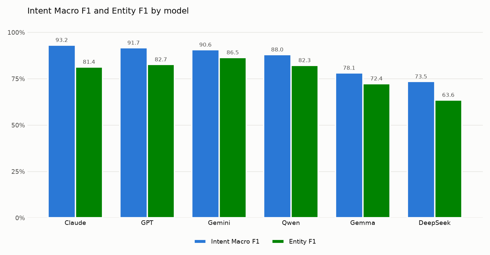

# Myanglish-BizBench: Can general-purpose LLMs understand Myanglish customer messages?

**Final report — benchmark v0.2 (frozen 2026-11-19)**

## Abstract

Myanglish — Burmese written in Latin letters, often mixed with English — is how many people in
Myanmar message online shops, but no public benchmark measures how well LLMs understand it.
Myanglish-BizBench is a 100-message test set of e-commerce customer messages annotated with 12
business intents (multi-label) and 15 entity types. We evaluated six LLMs zero-shot with
structured JSON output. On the final version (v0.2), the best models reach an intent Macro F1 of
91–93% (Claude, GPT, Gemini; statistically tied) and an entity F1 of 81–87%. Open-weight models
trail: DeepSeek 73.5% and Gemma 78.1% Macro F1. Two findings matter most for practice: (1) pure
Myanglish without English words is much harder — 7 to 29 points lower intent F1 than code-mixed
messages, for every model; and (2) most remaining errors on the frontier models come from label
ambiguity, not misunderstanding. Our conclusion is that **fine-tuning is not needed to build a
useful Myanglish customer-message classifier today**; a frontier API model with a clear labelling
policy is enough, and the main open problem is authentic, pure-Myanglish evaluation data.

## 1. Introduction

Small online sellers in Myanmar take most orders through Facebook Messenger and Viber. Customer
messages are short, informal and written in Myanglish, with inconsistent spelling (`bl lout lal`,
`bal lout lel` = "how much?"), heavy abbreviation (`ph ph tr lay`) and English shop vocabulary
(`deli`, `COD`, `size M`). Automating replies needs two things: knowing **what** the customer wants
(intent) and pulling out **the details** (product, size, colour, payment method, location…).

Research questions:

1. How well do current general-purpose LLMs classify Myanglish customer intents and extract
   business entities, with no examples or fine-tuning?
2. Where do they fail — on the language, on multi-intent messages, or on the evaluation itself?
3. What is the cost and latency of each model, and which is practical for a real shop?

## 2. Dataset

### 2.1 Construction

| Step | What was done | Artifact |
|---|---|---|
| Generation | Four LLMs (ChatGPT, Claude, DeepSeek, Gemini) each generated 25 messages with labels from a common brief | `data/raw/` |
| Human correction | A native Burmese speaker rewrote unnatural messages and corrected labels | `data/human-fixed/` |
| Merge + IDs | 100 records, `mbb_0001`–`mbb_0100`, `source_model` kept | `data/interim/merged.json` |
| Validation | Schema, label sets, duplicates, Myanmar script in `normalized_burmese` | `scripts/validate_dataset.py` |
| Entity standardisation | 60 ad-hoc keys mapped to a 15-key schema | `scripts/standardize_entities.py` |
| Freeze v0.1 | Read-only file + SHA-256 manifest | `data/v0.1/` |
| v0.2 relabelling | Written guidelines; blind human review (no model predictions shown) | `reports/annotation_guidelines_v0.2.md`, `data/v0.2/` |

Each record has the message `text`, a `normalized_burmese` rendering in Myanmar script, an
`english_meaning`, multi-label `intents`, `entities`, `writing_style`, `difficulty`, optional
`context`, and `requires_clarification`.

### 2.2 Composition

| Property | Value |
|---|---|
| Messages | 100 (25 per source model) |
| Intent labels | 12; 148 annotations, 1.48 per message |
| Multi-intent messages | 39 (31 with two intents, 8 with three or more) |
| Writing style | 64 Myanglish + English, 36 pure Myanglish |
| Difficulty (annotator label) | 26 easy, 48 medium, 26 hard |
| Entities | 15 types, 105 gold (key, value) pairs in v0.2; 46 messages have none |
| Context-dependent | 4 messages |

Intents: `greeting`, `price_inquiry`, `product_inquiry`, `stock_availability`, `place_order`,
`payment_inquiry`, `delivery_inquiry`, `discount_inquiry`, `order_cancellation`,
`refund_exchange`, `customer_complaint`, `unknown`. Entity types: `product`, `brand`, `quantity`,
`size`, `color`, `variant`, `price`, `currency`, `location`, `payment_method`, `delivery_method`,
`delivery_fee`, `order_id`, `date_time`, `issue`.

Full statistics and charts: [`dataset_report.md`](dataset_report.md).

### 2.3 Versions

| | v0.1 | v0.2 |
|---|---|---|
| Messages | 100 | same 100, text unchanged |
| Intent labels | 148 | unchanged |
| Entity labels | free-text `issue`, multi-place `location` strings | `issue` from a fixed 13-value list, one value per place, 7 entities added by the reviewer (15 samples changed) |
| Prompt | v0.1 definitions | v0.2 definitions matching the written guidelines |
| SHA-256 | `4c3bddda…5a75a` | `6813b74f…6908b` |

Both versions are frozen and never edited. v0.2 rules were written **after** seeing v0.1 results;
this is disclosed and both versions are reported. Changes: [`v0.2_changelog.md`](v0.2_changelog.md).

## 3. Method

**Models.** GPT (`gpt-6.2-sol`, OpenAI API), Gemini (`gemini-4-carbon`, Google GenAI API), Claude
(`claude-opus-5-5`, Anthropic API), and three open-weight models via OpenRouter: DeepSeek
(`deepseek-v4-pro`), Qwen (`qwen4-max`) and Gemma (`gemma-4-31b-it`).

**Task setup.** Zero-shot. A system prompt defines each intent and entity type; the user turn
contains only the message. Every model must answer through **structured output** constrained to
a JSON schema (`intents`: array of the 12 labels; `entities`: list of `{key, value}` with the 15
keys). Provider defaults for temperature and reasoning. One run per model.

**Metrics.**

- *Intent Macro F1* — mean of per-intent F1 over the 12 labels (multi-label).
- *Intent Micro F1* — F1 pooled over all intent decisions.
- *Exact match* — the predicted intent set equals the gold set.
- *Entity F1* — over (key, normalised value) pairs; normalisation lower-cases, trims and parses
  numbers. *Entity key F1* ignores values.
- *Cost/1K* — measured input + output tokens (including reasoning tokens) × OpenRouter list price,
  per 1,000 messages.
- *Latency* — wall-clock seconds per request, including network.
- *Uncertainty* — 95% bootstrap confidence intervals (1,000 resamples of the 100 messages) and
  paired comparisons ([`v0.2/confidence_intervals.md`](v0.2/confidence_intervals.md)).

**Failure handling.** API errors (rate limits, timeouts) are retried and never scored. Invalid or
empty model answers count as wrong and are not retried. All six final runs are complete: 100/100
scored, 0 invalid answers.

Code: `src/` (adapters per provider, metrics, evaluator). Reproduce with
`python -m src.evaluator --version v0.2`.

## 4. Results

### 4.1 Main results (v0.2)

| Model | Macro F1 [95% CI] | Micro F1 | Exact match | Entity F1 [95% CI] | Cost/1K msgs | p90 latency |
|---|---|---|---|---|---|---|
| Claude | **93.2** [88.6–96.2] | **93.1** | **84.0** | 81.4 [75.2–87.2] | $10.82 | 3.9 s |
| GPT | 91.7 [86.9–95.1] | 91.8 | 81.0 | 82.7 [77.0–87.9] | $2.88 | 3.4 s |
| Gemini | 90.6 [85.4–94.1] | 90.3 | 79.0 | **86.5** [81.8–90.9] | $5.48 | 16.3 s |
| Qwen | 88.0 [82.3–92.1] | 87.6 | 75.0 | 82.3 [77.2–87.0] | $3.35 | 18.3 s |
| Gemma | 78.1 [70.0–83.5] | 78.6 | 62.0 | 72.4 [63.5–80.7] | **$0.22** | **1.8 s** |
| DeepSeek | 73.5 [65.2–79.2] | 71.8 | 53.0 | 63.6 [55.9–70.4] | $2.37 | 35.2 s |

- **Three tiers.** Claude, GPT and Gemini are statistically tied on intents (paired bootstrap:
  no pair separates in more than 90% of resamples). Qwen is a little behind (Claude beats it in
  98% of resamples). Gemma and DeepSeek are clearly lower (every frontier model beats them in
  100% of resamples).
- **Entities are close to intents now.** In v0.1 entity F1 was 64–76%; v0.2's fixed issue list
  and one-value-per-place rule raised it to 64–87%. Recall is 76–94%; precision 54–80% — models
  extract *more* than the gold, often legitimately (see §5.3).
- **Cost spans 50×.** Gemma costs $0.22 per 1,000 messages; Claude $10.82. GPT gives frontier
  accuracy at $2.88.

### 4.2 v0.1 → v0.2

| Model | Macro F1 | Exact match | Entity F1 |
|---|---|---|---|
| GPT | 94.0 → 91.7 | 86 → 81 | 71.1 → 82.7 |
| Gemini | 91.3 → 90.6 | 83 → 79 | 76.0 → 86.5 |
| Claude | 93.6 → 93.2 | 87 → 84 | 71.1 → 81.4 |
| DeepSeek | 76.8 → 73.5 | 62 → 53 | 63.1 → 63.6 |
| Qwen | 90.8 → 88.0 | 83 → 75 | 67.6 → 82.3 |
| Gemma | 75.3 → 78.1 | 66 → 62 | 63.7 → 72.4 |

Entity F1 rose by 9–15 points for five models. Intent scores fell slightly even though **no gold
intent changed** — the cause is the v0.2 prompt, which spells out the labelling rules: models now
follow those rules on messages whose gold labels do not (§5.4). All v0.1-to-v0.2 changes are within
or near the confidence intervals except the entity gains. Details:
[`v0.1_vs_v0.2.md`](v0.1_vs_v0.2.md).

### 4.3 What makes a message hard

| Model | Pure Myanglish (n=36) | Myanglish + English (n=64) | Gap |
|---|---|---|---|
| Claude | 86.3 | 96.8 | −10.5 |
| GPT | 87.4 | 94.2 | −6.8 |
| Gemini | 81.2 | 95.2 | −14.0 |
| Qwen | 78.0 | 92.6 | −14.6 |
| Gemma | 63.2 | 86.5 | −23.3 |
| DeepSeek | 53.3 | 81.9 | −28.6 |

*Intent micro F1, v0.2.*

**Language mix is the strongest predictor of difficulty.** English shop words (`refund`,
`discount`, `size`, `KPay`) act as anchors; without them, every model drops, and the weaker models
collapse. The annotator's `difficulty` label does *not* predict model errors (e.g. GPT: easy 86.7,
hard 93.2), so it describes human effort, not model difficulty.

**Multi-intent messages cost exact match, not F1.** Exact match falls from 67–90% on one-intent
messages to 29–74% on two-intent messages. Of the wrong answers on two-intent messages, 57 had
fewer intents than gold and 10 had more: models find the main request and drop the secondary one.

**No self-preference.** Each source model's messages are not easier for the same model family; the
DeepSeek-written messages (21 of 25 pure Myanglish) are the hardest for 5 of 6 models, including
DeepSeek itself (53.0 micro F1).

## 5. Failure analysis

Full tables: [`v0.2/failure_analysis.md`](v0.2/failure_analysis.md) (and the v0.1 version with
[`failure_analysis_findings.md`](failure_analysis_findings.md)).

### 5.1 Hardest intents

Lowest mean F1 across models: `unknown` (75.6), `place_order` (78.8), `price_inquiry` (82.4),
`stock_availability` (82.8). Easiest: `refund_exchange` (94.2), `order_cancellation` (92.8),
`discount_inquiry` (91.7) — the ones usually signalled by an English keyword.

### 5.2 Linguistic failures (real model weaknesses)

| Sample | Message | What goes wrong |
|---|---|---|
| `mbb_0051` | `ph ph tr lay tr ya ml lar` | Heavy abbreviation; no model reads it as a price question |
| `mbb_0088` | `… ah phone ka kwal nay tal …` | `ah phone` = "lid", read as phone by some models |
| `mbb_0027` | `a ko shi lr` ("bro, are you there?") | 4 of 6 read it as "do you have it?" (`stock_availability`) |
| `mbb_0071` | `order pyi tl order id ko pyan pr` | "send me the order ID" read as a delivery question by 5 of 6 |

Weak models also miss entities written only in Myanglish (DeepSeek and Gemma: `date_time` recall
50% and 38%).

### 5.3 Evaluation-related failures (fixed in v0.2)

The v0.1 analysis found that about three in four of the hardest failures came from the
evaluation: free-text `issue` values that could never match (112 "extra" predictions), location
format differences (`Yankin, Yangon` vs two values), and missing gold entities (`mbb_0055`
KBZPay / CB Pay). v0.2 fixed these, which accounts for the entity F1 gain.

### 5.4 Remaining label-guideline conflicts (for v0.3)

In about 9 v0.2 samples, the gold intents contradict the written v0.2 guidelines, and all or most
models follow the guidelines:

| Sample | Gold | Guideline says | Models |
|---|---|---|---|
| `mbb_0024` `yout pyi lar` | unknown | rule 7: `delivery_inquiry` | 6/6 delivery_inquiry |
| `mbb_0059`, `mbb_0018` | discount + price | rule 2: discount only | 6/6, 5/6 discount only |
| `mbb_0053`, `mbb_0067` | stock + product | rule 4: stock only | 5/6, 6/6 stock only |
| `mbb_0083` `hello …` | complaint + delivery | rule 3: + greeting | 6/6 add greeting |
| `mbb_0069` | complaint + delivery | rule 5: complaint only (no delivery question) | 5/6 complaint only |
| `mbb_0094`, `mbb_0013` | cancellation + place_order | rule 6: keeping part is not a new order | 4/6, 3/6 cancellation only |

These are not fixed in v0.2 (it is frozen). A model that follows the written rules exactly is
capped at about 91% exact match, and these samples explain most of the v0.1-to-v0.2 intent drop. They should be resolved in
v0.3 by a second annotator, with inter-annotator agreement reported.

### 5.5 Latency

Only Gemma meets a p90 ≤ 3 s real-time budget (1.8 s). GPT (3.4 s) and Claude (3.9 s) are close
enough for chat; Gemini, Qwen and DeepSeek spend many reasoning tokens (265–884 per message) and
reach p90 of 16–35 s.

## 6. Limitations

- **Not real customer messages.** Messages were generated by four of the evaluated model families
  and corrected by one human. Real messages are likely noisier (more typos, voice-to-text,
  stickers, Zawgyi/Unicode Burmese script mixed in). Scores here are probably an upper bound.
- **Small.** 100 messages, 7–21 per intent; confidence intervals are ±4–8 points. Differences
  smaller than about 5 points should not be read as rankings.
- **One annotator.** No inter-annotator agreement; §5.4 shows label ambiguity remains.
- **Sparse entities.** 46 messages have no entities; `brand`, `delivery_fee` and `order_id` never
  occur in gold.
- **Rules written after seeing results.** v0.2 guidelines and prompt were informed by v0.1
  failures. Gold intents were not changed, but the entity gains partly reflect rules chosen to fix
  known matching problems.
- **Single zero-shot run per model**, default settings, list prices at evaluation time. Few-shot
  prompting, self-consistency and fine-tuned small models were not tested.
- **Text only.** Real chats include images (product screenshots, payment slips).

## 7. Conclusions

1. **Frontier LLMs already understand Myanglish shop messages well enough for production triage**
   — 91–93% intent Macro F1 and 81–87% entity F1, zero-shot, with no Myanglish training data.
2. **Fine-tuning is not justified by this evidence.** Most remaining frontier errors are label
   ambiguity, not language failures. The case for a fine-tuned small model is cost and latency,
   not accuracy — and Gemma already runs at $0.22/1K and 1.8 s p90 with 78% Macro F1.
3. **Pure Myanglish is the real gap.** Without English anchor words, scores fall 7–29 points. The
   most valuable next dataset is authentic, pure-Myanglish customer messages.
4. **The labelling policy matters as much as the model.** Writing down the rules raised entity F1
   by about 10 points with no model change; a product needs the same written policy in its prompt.

**Practical recommendation.** For a Myanglish customer-message assistant, use **GPT** as the
default (frontier-tier accuracy, lowest frontier cost at $2.88/1K, p90 3.4 s), with Claude as a
higher-accuracy alternative and Gemma for very high-volume, low-cost pre-filtering. Route
low-confidence or pure-Myanglish messages to a human. This is implemented in
[`app/`](../app/README.md).

## 8. Future work

- v0.3: second annotator, resolve §5.4, report Cohen's κ.
- Collect 300–500 authentic, consented, anonymised customer messages (with shop owners).
- Few-shot and self-consistency baselines; a fine-tuned small model as a cost baseline.
- Burmese-script and Zawgyi inputs; image messages.

## Reproducibility

| Item | Location |
|---|---|
| Frozen datasets + manifests | `data/v0.1/`, `data/v0.2/` |
| Raw generations, human fixes, review sheets | `data/raw/`, `data/human-fixed/`, `data/v0.2/` |
| Every model prediction (raw output, tokens, latency) | `results/predictions/`, `results/v0.2/predictions/` |
| Scores and prices | `results/**/results.json`, `results/pricing.json` |
| Checksums for all data and results | `SHA256SUMS.txt` (`python scripts/make_checksums.py --check`) |
| Evaluation code | `src/` |
| Analysis scripts | `scripts/` |
