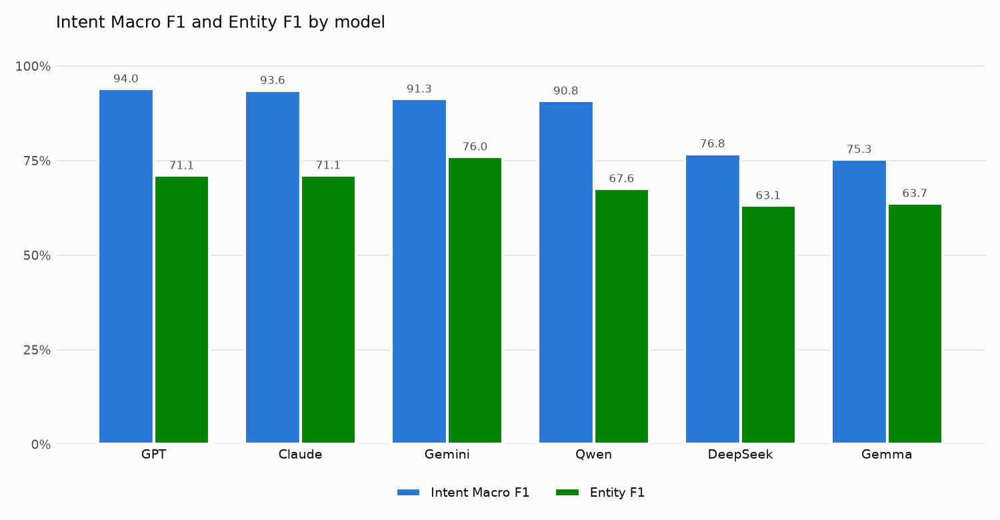

### Preliminary Findings

We evaluated six large language models on Myanglish-BizBench v0.1, a human-rewritten benchmark containing 100 Myanglish customer messages across 12 business intent categories.

Four models achieved intent classification Macro F1 scores above 90%, with GPT achieving the highest score of 94.0%. However, entity extraction performance was substantially lower across all evaluated models, with Gemini achieving the highest entity F1 score of 76.0%.

The results also revealed a significant cost-performance trade-off. Gemma achieved an intent Macro F1 score of 75.3% at an estimated cost of $0.15 per 1,000 messages, approximately 14 times cheaper than GPT.

These preliminary findings suggest that general-purpose LLMs possess considerable Myanglish intent understanding capabilities. However, structured business information extraction and cost-efficient inference remain potential areas for improvement.

Further failure analysis, few-shot evaluation and independent human-written benchmarks are required to determine whether specialized fine-tuning is justified.

#### Limitations

The benchmark messages were generated by four of the evaluated model families (GPT, Claude, Gemini and DeepSeek) and then corrected by a human annotator; they are not real customer messages. Models may therefore score higher on this text than on authentic Myanglish written by customers. The test set is also small (100 messages, with only 7 to 21 samples per intent), so differences of a few points between models are not statistically reliable. Entity annotations are sparse: 46 of the 100 messages contain no labelled entities, and the `brand`, `delivery_fee` and `order_id` entity types never occur, so entity F1 rests on a limited set of examples. All models were evaluated zero-shot with default provider settings, and costs are estimates based on list prices at the time of evaluation.

Source: [`results/results.md`](../results/results.md) (full results table, per-intent F1, costs and method).
