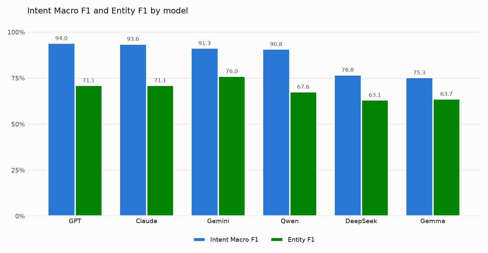

# Myanglish-BizBench v0.1 — model results

Test set: `data/v0.1/test.jsonl` (100 samples). Generated 2026-11-18 17:12 UTC by `python -m src.evaluator`.

| Model | Model ID | Macro F1 | Micro F1 | Exact match | Entity F1 | Cost/1K |
|---|---|---|---|---|---|---|
| GPT | `gpt-6.2-sol` | 94.0 | 93.8 | 86.0 | 71.1 | $2.10 |
| Gemini | `gemini-4-carbon` | 91.3 | 91.6 | 83.0 | 76.0 | $3.93 |
| Claude | `claude-opus-5-5` | 93.6 | 93.8 | 87.0 | 71.1 | $8.59 |
| DeepSeek | `deepseek/deepseek-v4-pro` | 76.8 | 77.3 | 62.0 | 63.1 | $1.99 |
| Qwen | `qwen/qwen4-max` | 90.8 | 90.9 | 83.0 | 67.6 | $2.65 |
| Gemma | `google/gemma-4-31b-it` | 75.3 | 77.4 | 66.0 | 63.7 | $0.15 |

F1 and exact match are percentages. **Cost/1K** is the US-dollar cost of annotating 1,000 messages, from measured token usage (including reasoning tokens) times list prices from the OpenRouter catalog (fetched 2026-11-18).

⚠ marks an incomplete run: some samples have no prediction because the API request failed (not counted as wrong). Those scores are not comparable with complete runs until the missing samples are re-run (`python -m src.evaluator --models <name>`).

## Run details

| Model | Scored | Missing | Bad answers | Entity key F1 | Input tokens | Output tokens | Run cost | Mean latency (s) |
|---|---|---|---|---|---|---|---|---|
| GPT | 100 | 0 | 0 | 79.8 | 74,633 | 6,077 | $0.21 | 2.2 |
| Gemini | 100 | 0 | 0 | 83.3 | 105,759 | 18,168 | $0.39 | 7.5 |
| Claude | 100 | 0 | 0 | 80.9 | 141,549 | 14,661 | $0.86 | 2.5 |
| DeepSeek | 100 | 0 | 0 | 72.9 | 69,388 | 90,785 | $0.20 | 18.8 |
| Qwen | 100 | 0 | 0 | 78.4 | 87,265 | 32,906 | $0.27 | 8.5 |
| Gemma | 100 | 0 | 0 | 78.6 | 65,127 | 5,025 | $0.02 | 1.3 |

## Intent micro F1 by the model that generated the sample

The test messages were written by GPT, Claude, DeepSeek and Gemini. A model scoring higher on its own samples is a sign of self-preference bias.

| Model | chatgpt | claude | deepseek | gemini |
|---|---|---|---|---|
| GPT | 95.7 | 100.0 | 86.4 | 94.6 |
| Gemini | 92.8 | 100.0 | 81.5 | 94.3 |
| Claude | 97.1 | 98.5 | 88.9 | 91.4 |
| DeepSeek | 88.6 | 80.6 | 64.3 | 78.4 |
| Qwen | 94.3 | 92.3 | 82.5 | 95.8 |
| Gemma | 80.6 | 86.2 | 64.0 | 80.6 |

## Per-intent F1

| Intent | GPT | Gemini | Claude | DeepSeek | Qwen | Gemma |
|---|---|---|---|---|---|---|
| greeting | 82.4 | 82.4 | 82.4 | 81.8 | 82.4 | 62.5 |
| price_inquiry | 92.3 | 89.5 | 90.0 | 73.7 | 89.5 | 62.5 |
| product_inquiry | 84.6 | 84.6 | 83.3 | 69.0 | 88.9 | 71.4 |
| stock_availability | 92.9 | 92.9 | 96.3 | 74.3 | 96.0 | 77.4 |
| place_order | 96.0 | 87.0 | 95.7 | 81.8 | 96.0 | 90.9 |
| payment_inquiry | 100.0 | 90.9 | 95.7 | 87.0 | 87.0 | 95.7 |
| delivery_inquiry | 90.9 | 91.4 | 97.1 | 78.8 | 90.9 | 88.2 |
| discount_inquiry | 100.0 | 100.0 | 100.0 | 88.9 | 94.7 | 73.7 |
| order_cancellation | 100.0 | 100.0 | 100.0 | 76.9 | 94.1 | 71.4 |
| refund_exchange | 100.0 | 100.0 | 100.0 | 81.8 | 95.2 | 95.2 |
| customer_complaint | 96.6 | 100.0 | 96.6 | 81.5 | 88.9 | 81.5 |
| unknown | 92.3 | 76.9 | 85.7 | 46.2 | 85.7 | 33.3 |

## Method

- Zero-shot. Every model gets the same system prompt (`src/schemas.py`) listing the 12 intents and 15 entity keys, and must answer in a fixed JSON schema (provider structured-output mode where available).
- Provider default settings: no temperature or reasoning-effort overrides.
- **Macro F1**: mean of per-intent F1 (multi-label). **Micro F1**: F1 over all intent labels. **Exact match**: predicted intent set equals the gold set. **Entity F1**: micro F1 over (key, value) pairs after lenient normalisation (case, spacing, underscores; digits only for quantity, price and delivery fee).
- Unparseable or empty answers count as empty predictions (no intents, no entities). Failed API requests are reported as missing instead.
