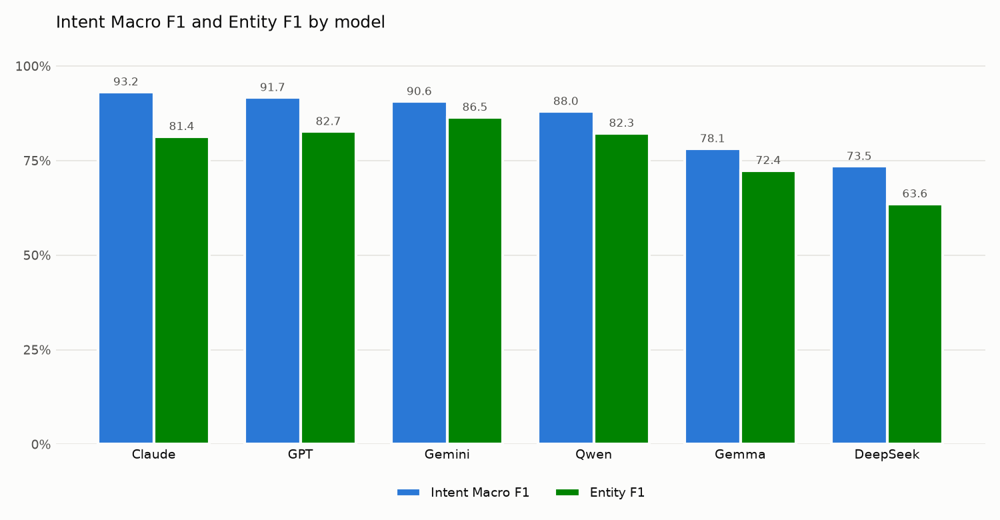

# Myanglish-BizBench v0.2 — model results

Test set: `data/v0.2/test.jsonl` (100 samples). Generated 2026-11-18 19:33 UTC by `python -m src.evaluator --version v0.2` (prompt version v0.2).

| Model | Model ID | Macro F1 | Micro F1 | Exact match | Entity F1 | Cost/1K |
|---|---|---|---|---|---|---|
| GPT | `gpt-6.2-sol` | 91.7 | 91.8 | 81.0 | 82.7 | $2.88 |
| Gemini | `gemini-4-carbon` | 90.6 | 90.3 | 79.0 | 86.5 | $5.48 |
| Claude | `claude-opus-5-5` | 93.2 | 93.1 | 84.0 | 81.4 | $10.82 |
| DeepSeek | `deepseek/deepseek-v4-pro` | 73.5 | 71.8 | 53.0 | 63.6 | $2.37 |
| Qwen | `qwen/qwen4-max` | 88.0 | 87.6 | 75.0 | 82.3 | $3.35 |
| Gemma | `google/gemma-4-31b-it` | 78.1 | 78.6 | 62.0 | 72.4 | $0.22 |

F1 and exact match are percentages. **Cost/1K** is the US-dollar cost of annotating 1,000 messages, from measured token usage (including reasoning tokens) times list prices from the OpenRouter catalog (fetched 2026-11-18).

⚠ marks an incomplete run: some samples have no prediction because the API request failed (not counted as wrong). Those scores are not comparable with complete runs until the missing samples are re-run (`python -m src.evaluator --models <name>`).

## Run details

| Model | Scored | Missing | Bad answers | Entity key F1 | Input tokens | Output tokens | Run cost | Mean latency (s) |
|---|---|---|---|---|---|---|---|---|
| GPT | 100 | 0 | 0 | 86.1 | 107,233 | 7,375 | $0.29 | 2.3 |
| Gemini | 100 | 0 | 0 | 89.1 | 141,159 | 26,520 | $0.55 | 8.9 |
| Claude | 100 | 0 | 0 | 85.7 | 188,649 | 16,379 | $1.08 | 2.6 |
| DeepSeek | 100 | 0 | 0 | 72.9 | 116,026 | 88,434 | $0.24 | 15.8 |
| Qwen | 100 | 0 | 0 | 84.8 | 121,065 | 38,111 | $0.34 | 8.7 |
| Gemma | 100 | 0 | 0 | 82.4 | 100,919 | 5,577 | $0.02 | 1.1 |

## Intent micro F1 by the model that generated the sample

The test messages were written by GPT, Claude, DeepSeek and Gemini. A model scoring higher on its own samples is a sign of self-preference bias.

| Model | chatgpt | claude | deepseek | gemini |
|---|---|---|---|---|
| GPT | 88.2 | 97.0 | 89.2 | 93.3 |
| Gemini | 92.5 | 97.0 | 80.5 | 93.2 |
| Claude | 94.1 | 100.0 | 86.4 | 93.3 |
| DeepSeek | 87.3 | 78.3 | 53.0 | 72.0 |
| Qwen | 91.2 | 95.4 | 78.0 | 88.0 |
| Gemma | 82.4 | 81.2 | 68.4 | 83.3 |

## Per-intent F1

| Intent | GPT | Gemini | Claude | DeepSeek | Qwen | Gemma |
|---|---|---|---|---|---|---|
| greeting | 84.2 | 90.0 | 95.2 | 80.0 | 84.2 | 90.0 |
| price_inquiry | 92.3 | 89.5 | 92.3 | 70.6 | 83.3 | 66.7 |
| product_inquiry | 92.3 | 84.6 | 92.3 | 74.1 | 84.6 | 73.3 |
| stock_availability | 92.9 | 89.7 | 92.3 | 57.9 | 86.7 | 77.4 |
| place_order | 80.0 | 76.2 | 90.9 | 64.0 | 76.2 | 85.7 |
| payment_inquiry | 100.0 | 90.9 | 91.7 | 83.3 | 90.9 | 91.7 |
| delivery_inquiry | 88.2 | 88.2 | 91.4 | 70.3 | 88.9 | 78.8 |
| discount_inquiry | 100.0 | 100.0 | 100.0 | 82.4 | 90.0 | 77.8 |
| order_cancellation | 100.0 | 100.0 | 100.0 | 80.0 | 100.0 | 76.9 |
| refund_exchange | 100.0 | 100.0 | 95.2 | 80.0 | 100.0 | 90.0 |
| customer_complaint | 90.3 | 92.9 | 93.3 | 66.7 | 85.7 | 83.3 |
| unknown | 80.0 | 85.7 | 83.3 | 72.7 | 85.7 | 46.2 |

## Method

- Zero-shot. Every model gets the same system prompt (`src/schemas.py`) listing the 12 intents and 15 entity keys, and must answer in a fixed JSON schema (provider structured-output mode where available).
- Provider default settings: no temperature or reasoning-effort overrides.
- **Macro F1**: mean of per-intent F1 (multi-label). **Micro F1**: F1 over all intent labels. **Exact match**: predicted intent set equals the gold set. **Entity F1**: micro F1 over (key, value) pairs after lenient normalisation (case, spacing, underscores; digits only for quantity, price and delivery fee).
- Unparseable or empty answers count as empty predictions (no intents, no entities). Failed API requests are reported as missing instead.
